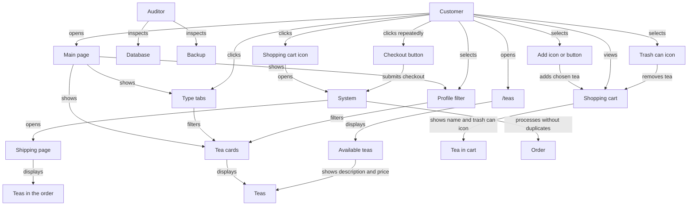
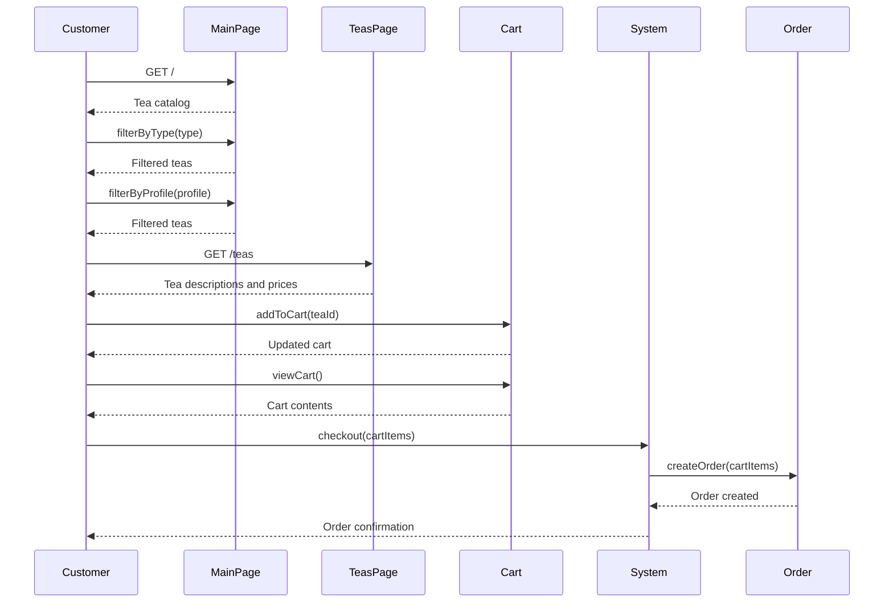

| UC-01 step | Action | Component that handles it |
|---|---|---|
| 1 | Customer clicks the shopping cart icon. | **Cart/navigation UI** — displays the icon and sends the customer to the shipping route when clicked. |
| 2 | System opens the shipping page. | **Shipping route in `app.py`** — handles the request and loads the shipping page template. |
| 3 | System displays the teas in the order. | **Shipping route, order/cart data, and shipping page template** — gets the teas from the customer’s order and displays them. |
