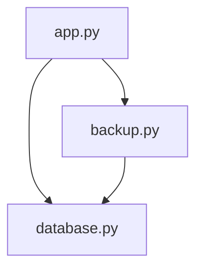

**Decision:** Copy each Tea object’s details when database.py creates an Order.

**Because:** create_order copies the cart’s list, but the teas inside it are still the same mutable objects used by the catalog; changing one could change the details shown in an existing order.

**Rejected:** Leave the code as it is. The shared objects would still allow that change to affect an existing order.

**Rejected:** Make Tea immutable. That would also change how catalog teas can be updated, which is a broader change than this order fix needs.

**Costs:** Change database.py. Each order will hold its own copies of the tea details.

After this change, database.py will be imported by 2 files instead of 2.
If we add an in-session route to edit a catalog tea’s name or price while preserving existing orders, we will edit 1 file (app.py) instead of 2 (app.py and database.py). We will check on November 2, 2026.
