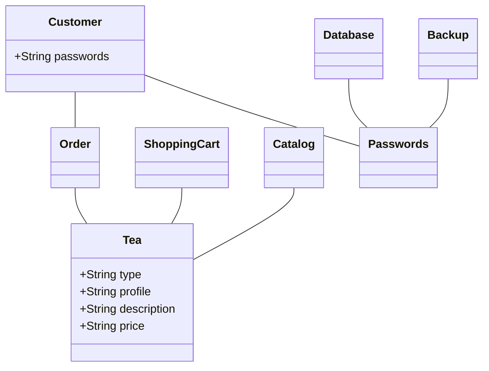
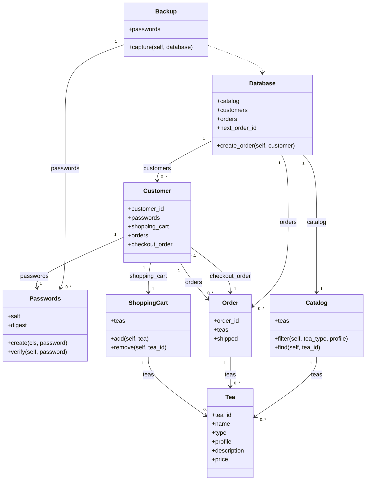

| Rank | File | Project files it imports | Project files importing it |
|---:|---|---:|---:|
| 1 | `tea.py` | 0 | 4 |
| 2 | `passwords.py` | 0 | 3 |
| 3 | `order.py` | 1 | 2 |
| 4 | `catalog.py` | 1 | 2 |
| 5 | `customer.py` | 3 | 2 |
| 6 | `database.py` | 3 | 2 |
| 7 | `shopping_cart.py` | 1 | 1 |
| 8 | `backup.py` | 2 | 1 |
| 9 | `app.py` | 6 | 0 |

tea.py represents a tea using its ID, name, type, profile, description, and price. Its fields support one purpose, so it has functional cohesion on the seven-level scale. Four files import it—`shopping_cart.py`, order.py, catalog.py, and app.py—giving it afferent coupling of four. The repository has no pull request documenting tea.py as an intentional shared foundation, so we classify its growth as accidental. Splitting it would involve reviewing and potentially updating tea.py and those four importing files, depending on which code moves.
